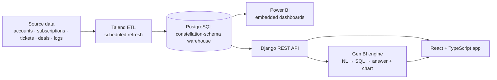

# Hi, I'm Rania 👋

### Data & AI Engineer

Engineer from **ESPRIT** (graduated with honors, *Mention Très Bien*).
I build the full data path: **ETL → data warehouse → BI → applications → AI on top of the data.**

---

## About me

- 🎓 Engineering degree from **ESPRIT**, after a two-year preparatory cycle at IPEIEM.
- 🏗️ I design **data warehouses and ETL pipelines**, turn them into **dashboards people actually use**, and add **AI features** (natural language → SQL) on top.
- 🧩 Comfortable across the stack: data engineering, BI, back end and front end.
- 🔎 **Looking for a Data Engineer / AI Engineer position.**

---

## 💼 Experience

| Period | Role | What I did |
|---|---|---|
| Feb – Sep 2026 | **End-of-study internship**, MEDIANET | MEDIANET Nexus: AI-assisted CRM platform, PostgreSQL warehouse with Talend ETL, role-based Power BI dashboards, Medianaute NL-to-SQL assistant |
| Jun – Aug 2025 | **Engineering internship**, MEDIANET | Amazon data pipeline: scraping with BeautifulSoup, SQL Server star-schema warehouse loaded with Talend, Power BI dashboard with daily automatic refresh |
| Jul – Aug 2024 | **Summer internship**, Be-Softilys | Tutorials management web app: Spring Boot REST API, Angular front end, PostgreSQL |

**Academic projects:** Graph-RAG product recommendation chatbot · Video emotion recognition (CNN + Autoencoder + LSTM)

---

## ⭐ Featured project: MEDIANET Nexus (end-of-studies project)

A **customer success and analytics platform** built during my final-year internship at **MEDIANET**.
It brings subscription, support, sales and usage data into one governed warehouse, exposes it through dashboards and a web app, and lets users **ask questions in plain French or English**.

| Layer | What I built |
|---|---|
| **Data engineering** | Star-schema warehouse in PostgreSQL, loaded with Talend (dimensions first, then facts), refreshed on a schedule or on demand |
| **BI** | Power BI dashboards with DAX measures for sales pipeline and customer success KPIs |
| **Application** | React + TypeScript front end, Django REST back end, role-based access, bilingual interface |
| **AI** | **Medianaute**, a bilingual text and voice assistant: language and intent detection, natural language → SQL, AST-based SQL validation, answers with charts, Groq → Mistral fallback, Whisper speech-to-text. Answers evaluated with BERTScore and LLM-as-a-judge (88% intent accuracy) |

👉 **[See the full project](https://github.com/Rania-BenHmida/MEDIANET-Nexus)**

---

## 🛠️ Tech stack

**Data engineering**

**BI & analytics**

**AI**

**Full stack**

---

## 📌 Other projects

| Project | What it is | Stack |
|---|---|---|
| [**Price_comparator**](https://github.com/Rania-BenHmida/Price_comparator) | Team project: price comparison across supermarket products, hotels and flights, with scrapers, Talend ETL, a Flask API, forecasting models (ARIMA / SARIMA) and Power BI dashboards | Flask · MySQL · SQL Server · Talend · Power BI |
| [**Dashboard_Amazon**](https://github.com/Rania-BenHmida/Dashboard_Amazon) | Multi-source Amazon data integration: scraping, pandas cleaning into one schema, Talend ETL and a Power BI report | Python · Talend · Power BI |
| [**Soccer-Predictor**](https://github.com/Rania-BenHmida/Soccer-Predictor) | Team ML project on Premier League data: predicts a player's best position (five models compared, up to 88% accuracy), ranks players by position, with a Flask app and Power BI report | Python · scikit-learn · XGBoost · Flask |
| [**Tutorials_App**](https://github.com/Rania-BenHmida/Tutorials_App) | Tutorials management web app from my 2024 internship at Be-Softilys, with the full project report | Spring Boot · Angular · PostgreSQL |

---

## 📫 Let's talk

I'm looking for a **Data Engineer / AI Engineer** role. The best way to reach me is on [LinkedIn](https://www.linkedin.com/in/rania-ben-hmida-586724291/).
